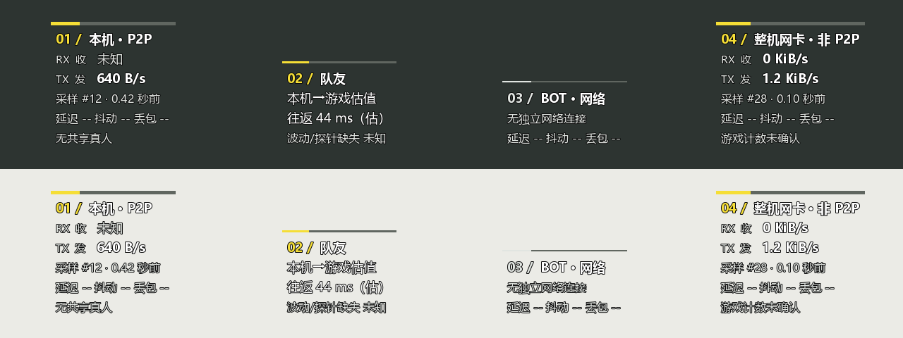

# conflictmodlist


装备大厅自动显示团队网络分析，无需点击或房主安装。需要查模组时，再点对应真人栏里的「模组对照」。

## 安装和使用

1. 在 r2modman 或 Thunderstore Mod Manager 的 GTFO 社区安装或更新 `HawChow-conflictmodlist`。手动安装时，退出游戏，将 ZIP 中的 `plugins/conflictmodlist.dll` 放入当前配置的 `BepInEx/plugins/`，只保留一份。
2. 网络文字直接挂在原生装备栏上，随该栏出现和移动，不等所有武器图标。正常贴在「模组对照」上方 2 像素；没有可用按钮行时，已展开的栏使用 NetworkQualityTracker 的原生位置。BOT 不创建按钮，空栏不显示；看板不接管点击。
3. 大厅和局内按 `Esc` 打开的装备页都有「模组对照」入口。看板随装备栏的视差移动，不锁屏幕像素；点击真人栏的入口可查看团队版本表及选中玩家。用大厅光标点右上角「关闭」或按 `Esc` 退出。长清单可用滚轮、键盘和可拖滑块。

从旧的拼写错误包 `confilctmodlist` 迁移时，先移除旧包，避免重复加载；已经在用 `conflictmodlist` 的玩家直接更新即可。

## 联机怎么看

| 情况 | 表格显示 |
| --- | --- |
| 只有自己安装 | 显示自己的模组版本，队友列标灰「未同步」。 |
| 房主未安装，多名客机已安装 | 已安装的客机可互相查看；房主列标灰「未同步」。 |
| 全队安装并同步 | 对照全队已加载的 BepInEx 模组版本。 |
| 单人 / 只有自己 + BOT | 不做队友比较，直接列本机已加载的插件与版本，标题为「本机模组清单」。 |

已安装的玩家通过 Steam 大厅共享自己的模组名称、GUID 和版本。不读取队友磁盘，也不需要房主转发。「未同步」不等于对方没有安装模组。

## 大厅常显网络分析



未确认支持合作探针的队友，只使用游戏已经缓存的正值 `SNet_Player.Ping`，标为游戏估值（采样时间未知）；无有效估值时显示未知。1.1.4 起不再为测延迟构造 Steam 身份或查询 Steam Messages 会话。

本机速率区分游戏载荷和整机网卡。不能确认游戏计数时不填零；若有网卡采样，则单独标注为整机收发（包含其他程序），不会作为 GTFO 流量报告给队友。

同装客户端通过独立成员字段互报，无需房主转发。合作探针的往返包含双方轮询等待：界面显示链路可能范围和应用层波动，并将缺收/缺发限定为探针缺号，不等同于游戏包丢包。没有足够样本、没有会话和报告过期不填零。不向未声明支持的玩家发探针，不用聊天或地图标记测速。

显示依据与取舍见[网络测量说明](https://github.com/hawchou1995/conflictmodlist/blob/v1.1.8/docs/network-research.md)。[多人复测清单](https://github.com/hawchou1995/conflictmodlist/blob/v1.1.8/docs/live-check.md) 区分单客机、双客机和混装。

## 颜色和筛选

- `↑` 表示该行已知最高版本（含并列），`↓` 加黄色强调表示低于最高版本。缺少清单或版本的单元格使用状态文字，读表不依赖颜色。
- 默认隐藏全队都加载且版本一致的模组。开启配置后，一致项在表格末尾单独显示。两个分组各自按已知加载人数降序，再按模组名称降序排列。
- 只比较 BepInEx 实际加载的模组，不比较安装包版本、未加载文件或独立 TheArchive 模块。版本号一致不代表 DLL、配置或兼容性一致。
- 表头玩家名优先照大厅原生 TMP 的实际渲染结果画：保留大厅改写后的大小写/缩写和逐字颜色；读不到原生结果时才解析昵称里的颜色标签，最后才用原始昵称。IMGUI 侧不开富文本，名字按「文字 + 颜色」分段绘制，远端昵称不会被当富文本执行；本机列追加的「（你）」是独立一段，不会被名字末尾的颜色染掉。

如需显示一致项，退出游戏后编辑 `BepInEx/config/hawchow.conflictmodlist.cfg`：

```ini
[Display]
ShowMatchingMods = true
```

## 按键

| 按键 | 作用 |
| --- | --- |
| `F` | 在本次会话内切换「差异 / 全部」视图（不写配置文件）。 |
| `↑` / `↓` | 上下滚一行。 |
| `PgUp` / `PgDn` | 上下翻一页。 |
| `Home` / `End` | 跳到清单开头 / 末尾。 |
| `Esc` | 关闭表格。 |

拖动滑块、滚轮和按键修改的是同一个滚动位置。清单未溢出时不显示滚动条。采集为空与版本一致被筛掉有不同提示。

## 反馈与开黑

- 问题反馈与功能建议：[qingju.me](https://qingju.me)
- GTFO 开黑语音频道：[小黑盒开黑频道](https://chat.xiaoheihe.cn/in1wpsjd)

## 源码构建

一键构建并检查本地候选（PowerShell）：`./scripts/Verify-Release.ps1 -GtfoRoot '<含 BepInEx 的 GTFO 或 profile 根目录>'`。脚本只读游戏引用，输出到 `artifacts/`，不会安装或启动游戏。

需要 .NET SDK 7 或更新版本；闸门工程 `tests/FontInteropGate` 目标 `net8.0`，需要 .NET SDK 8 或更新版本。`GTFO_ROOT` 指向已生成 BepInEx 游戏接口程序集的目录：

```bash
dotnet build src/TeamModVersions.csproj -c Release -p:GtfoRoot="$GTFO_ROOT"
dotnet run --project tests/OfflineTests.csproj -c Release
```

本机没有 .NET 7 运行时（只有更新版本）时，用 rollforward 跑离线测试，不必改测试目标框架：

```bash
DOTNET_ROLL_FORWARD=LatestMajor dotnet run --project tests/OfflineTests.csproj -c Release
```

界面字体走 il2cpp interop，改这里容易踩到 JIT/类型加载失败。`tests/FontInteropGate` 用真实 GTFO interop 对生产 DLL 做两道检查：编译产物里 `UnityEngine.Font` 的精确调用点，以及驱动全帧所有调用点的 JIT（只编译不执行）。旧 DLL 应红、修好的 DLL 应绿；IL 解码失败一律判红，不会静默漏扫：

```bash
dotnet run --project tests/FontInteropGate/FontInteropGate.csproj -c Release -- \
  <conflictmodlist.dll> "$GTFO_ROOT/BepInEx/interop" "$GTFO_ROOT/BepInEx/core"
dotnet run --project tests/FontInteropGate/FontInteropGate.csproj -c Release -- \
  --selftest "$GTFO_ROOT/BepInEx/interop" "$GTFO_ROOT/BepInEx/core"
```

闸门工程目标 `net8.0`，需要 .NET SDK 8 或更新版本（与主工程的 net6.0 目标无关）。它只做类型加载/JIT：JIT 通过不等于运行时可调用，native 未实现或运行期抛异常、以及"字体真有中文字形""界面真画出来了"都不在其证明范围内。

注册面和大厅接线各有一道离线闸门。`tests/EntryRegistrationGate` 按 `ClassInjector` 的同一套枚举与过滤规则列出真正会进 il2cpp 元数据的方法，再用真实 `Il2CppClassPointerStore` 检查每个签名能否取到原生 class（取回 `IntPtr.Zero` 即判红）；`tests/LobbyWiringGate` 钉住大厅挂载点与模板来源的调用签名。两者都只做静态检查，不加载 `GameAssembly`、不注册 il2cpp 类型：

```bash
dotnet run --project tests/EntryRegistrationGate/EntryRegistrationGate.csproj -c Release -- \\
  <conflictmodlist.dll> "$GTFO_ROOT/BepInEx/interop" "$GTFO_ROOT/BepInEx/core"
dotnet run --project tests/LobbyWiringGate/LobbyWiringGate.csproj -c Release -- <conflictmodlist.dll>
```

编译、离线测试和实际多人游戏是不同的验证；实机步骤见上文，不能以程序集检查代替实机截图或真实 RTT。
